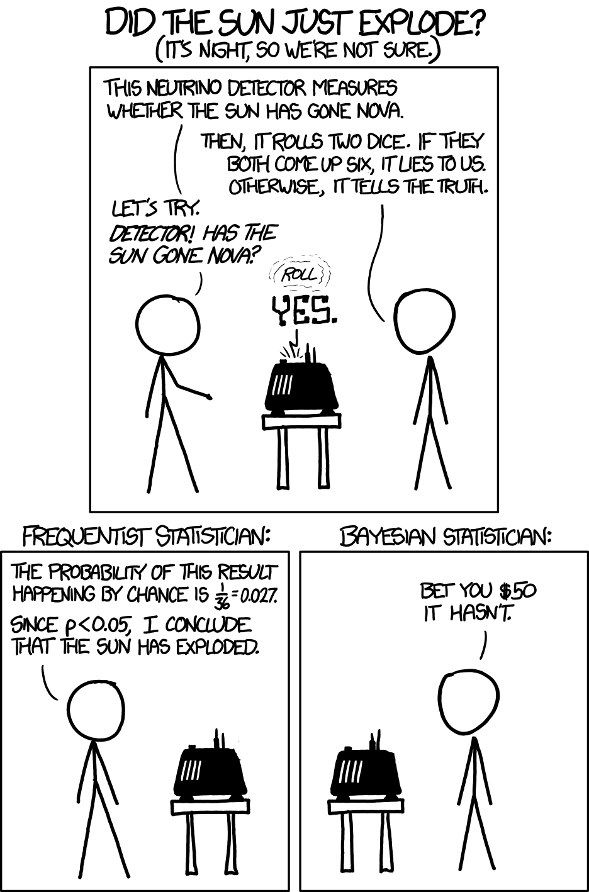

Bayesian inference gives us a way to **learn about an unknown quantity, describe our uncertainty, and revise our conclusions as evidence arrives.**

Throughout this lesson, we connected several ideas:

- **Prior, likelihood, and posterior play different roles.** The prior describes our starting uncertainty. The likelihood describes how the observed data depend on the parameter. Bayes’ rule combines them into the posterior.
- **The posterior is more than a single estimate.** Its mean summarizes the parameter’s location, while credible intervals and posterior probabilities describe which values remain plausible.
- **The balance between prior and data matters.** With limited data, different priors can produce different conclusions. Sensitivity checks make that dependence visible; more informative data generally reduce it.
- **Updating can happen in stages.** A posterior can become the prior for the next set of observations, allowing us to build on what we have already learned.
- **Learning about a parameter also helps us predict observations.** Posterior prediction accounts for both uncertainty about the parameter and randomness in new data.
- **The same reasoning applies across models.** Beta–Binomial and Gamma–Poisson models use different distributions, but follow the same logic: specify a prior and a data model, then update using evidence.

### What a probability refers to

> Does this probability describe the data, or the unknown?

A probability about data under an assumed parameter value is a frequentist statement. A probability about that parameter after observing the data is a Bayesian statement. Confidence intervals and credible intervals reflect the same distinction.

### Thank you for reading my blog :D Leaving you with a comic to reflect on your new Bayesian knowledge!

<input id="sun-flip" class="flip-check" type="checkbox">
<label class="flip-card" for="sun-flip">

Click for an explanation.

Click to return to the comic.
<strong>What happened?</strong> A detector reports that the sun has exploded. It lies only when two independent dice both show six:
P(detector lies) = (1/6) × (1/6) = 1/36 ≈ 2.8%
<strong>The frequentist character asks:</strong> “If the sun were fine, how likely would this report be?” The answer is 2.8%. Because this is below a 5% testing threshold, the character rejects “the sun is fine.”
<strong>The Bayesian character asks:</strong> “Given this report, how likely is an explosion?” An explosion was extraordinarily unlikely beforehand, so a detector error can still be the more plausible explanation.
<strong>The key:</strong> The probability of an alarm when the sun is fine is not the probability that the sun is fine after an alarm.

</label>

Randall Munroe, xkcd, “Frequentists vs. Bayesians.”

## References

::: {#refs}
:::
